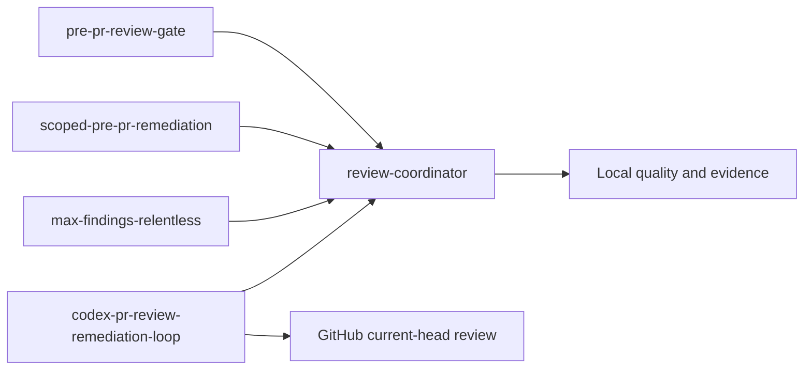
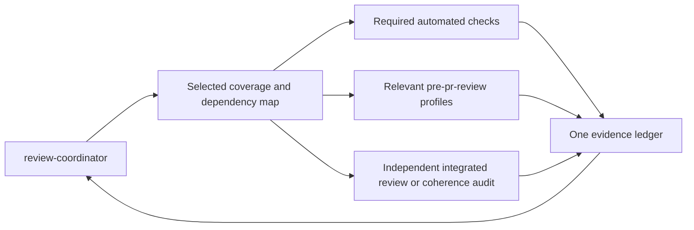
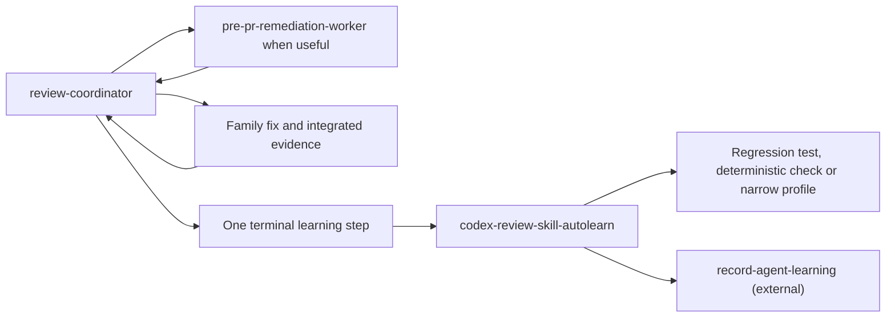
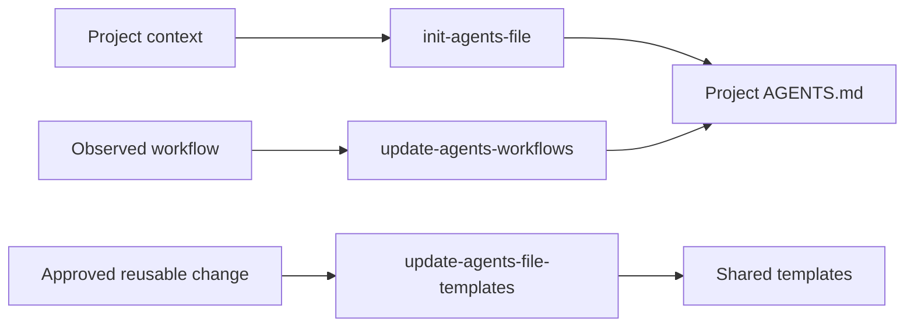
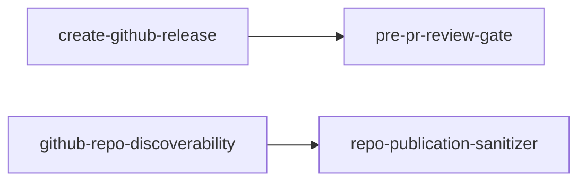
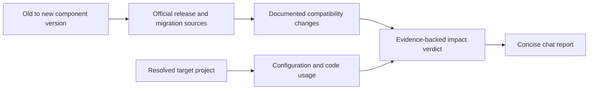

# Personal Agent Skills

Reusable AI-agent skills collected from local workflows and organized for the
`skills` CLI.

## Table of Contents

- [Install](#install)
- [Layout](#layout)
- [Project Files](#project-files)
- [Skills](#skills)
- [Skill Relations](#skill-relations)
- [Maintenance](#maintenance)
- [License](#license)

## Install

Install every skill from this repository:

```bash
npx --yes skills@latest add marcomc/skills --all --full-depth
```

List skills without installing:

```bash
npx --yes skills@latest add marcomc/skills --list --full-depth
```

Install a review entrypoint together with its shared coordinator:

```bash
npx --yes skills@latest add marcomc/skills --skill pre-pr-review-gate --skill review-coordinator --full-depth
```

`pre-pr-review-gate`, `scoped-pre-pr-remediation`, `max-findings-relentless`,
`pr-remediation-coherence-audit` and `codex-pr-review-remediation-loop` use the
companion `review-coordinator`. Select it too when installing individual skills;
installing all skills already includes it. Upgrade these entrypoints together.
The old cloud-loop helper paths remain compatibility forwards to the coordinator.

Install the template-maintenance pair together for out-of-sync reports:

```bash
npx --yes skills@latest add marcomc/skills --skill update-agents-file-templates --skill init-agents-file --full-depth
```

Their Python helpers require PyYAML and a separate template repository configured
through `--template-repo` or `AGENTS_TEMPLATE_REPO`.

For local validation from this checkout:

```bash
npx --yes skills@latest add . --list --full-depth
```

## Layout

Skills are grouped by category at the repository root as `<category>/<skill>/SKILL.md`.
Use `--full-depth` so the CLI scans every category directory.

## Project Files

| File | Purpose |
| --- | --- |
| [`AGENTS.md`](AGENTS.md) | Defines repository-specific agent maintenance rules. |
| [`CHANGELOG.md`](CHANGELOG.md) | Tracks public skill collection changes. |
| [`LICENSE`](LICENSE) | Declares the MIT license for reuse and distribution. |
| [`TODO.md`](TODO.md) | Tracks publication, curation, and maintenance follow-up. |
| [`.gitignore`](.gitignore) | Excludes local caches, generated artifacts, and environment files. |

## Skills

### Collection Management

| Skill | Purpose |
| --- | --- |
| [`comic-database-importer`](collection-management/comic-database-importer/SKILL.md) | Import comic-book records into the configured catalogue workbook while preserving its existing structure and data. |
| [`world-coin-banknote-cataloguer`](collection-management/world-coin-banknote-cataloguer/SKILL.md) | Identify and catalogue photographed world currency in Google Sheets. |
| [`gmail-coupon-cataloguer`](collection-management/gmail-coupon-cataloguer/SKILL.md) | Review Gmail discounts, update an existing Sheets catalogue and retain important purchase records during promotional-mail cleanup. |

### Email Management

| Skill | Purpose |
| --- | --- |
| [`gmail-filter-consolidation`](email-management/gmail-filter-consolidation/SKILL.md) | Audit Gmail filters and consolidate or remove rules only when behavior is preserved. |

### Codex Workflow

| Skill | Purpose |
| --- | --- |
| [`chatgpt-import`](codex-workflow/chatgpt-import/SKILL.md) | Import ChatGPT desktop conversations into Codex as coding-ready context. |
| [`codex-pr-review-remediation-loop`](codex-workflow/codex-pr-review-remediation-loop/SKILL.md) | Close defect families, reuse verified audit evidence, and monitor GitHub Codex review. |
| [`codex-review-skill-autolearn`](codex-workflow/codex-review-skill-autolearn/SKILL.md) | Distill completed Codex review remediations into reusable skill improvements. |
| [`compact-agents-file`](codex-workflow/compact-agents-file/SKILL.md) | Compact AI-agent instruction files while preserving intent. |
| [`consolidate-agent-learnings`](codex-workflow/consolidate-agent-learnings/SKILL.md) | Review agent-learning notes against current evidence and promote only bounded, reusable guidance. |
| [`init-agents-file`](codex-workflow/init-agents-file/SKILL.md) | Initialize project agent-instruction files from the task, repository and available templates. |
| [`jev-gateway-codex-desktop`](codex-workflow/jev-gateway-codex-desktop/SKILL.md) | Install Jev Gateway and configure Codex Desktop to route through it while preserving the existing ChatGPT login. |
| [`move-codex-chat`](codex-workflow/move-codex-chat/SKILL.md) | Move a Codex chat between local project contexts safely. |
| [`pr-remediation-coherence-audit`](codex-workflow/pr-remediation-coherence-audit/SKILL.md) | Audit cumulative fixes before publication and reconcile unchanged evidence after review. |
| [`project-context-rebuilder`](codex-workflow/project-context-rebuilder/SKILL.md) | Rebuild project context from repo docs, instructions, specs, and status files. |
| [`sync-codex-skills`](codex-workflow/sync-codex-skills/SKILL.md) | Sync shared `~/.agents/skills` entries into Codex-facing skill mirrors. |
| [`update-agents-workflows`](codex-workflow/update-agents-workflows/SKILL.md) | Update repository agent instructions from observed workflows and commands. |
| [`update-agents-file-templates`](codex-workflow/update-agents-file-templates/SKILL.md) | Review and apply approved reusable changes to agent-instruction templates. |

### Dependency Management

| Skill | Purpose |
| --- | --- |
| [`version-breaking-change-analysis`](dependency-management/version-breaking-change-analysis/SKILL.md) | Assess documented upgrade breaking changes against actual project usage. |

### Documentation

| Skill | Purpose |
| --- | --- |
| [`doc`](documentation/doc/SKILL.md) | Read, create, edit, and visually validate `.docx` documents. |
| [`document-project-flowcharts`](documentation/document-project-flowcharts/SKILL.md) | Add or refresh Mermaid flowcharts in project documentation. |

### Filesystem Organization

| Skill | Purpose |
| --- | --- |
| [`reorganize-folders`](filesystem-organization/reorganize-folders/SKILL.md) | Analyze and reorganize folders using safe move and rename operations. |
| [`verify-data-preservation`](filesystem-organization/verify-data-preservation/SKILL.md) | Verify filesystem migrations and media metadata preservation with persistent readback evidence. |

### macOS Administration

| Skill | Purpose |
| --- | --- |
| [`macos-disk-cleanup`](macos-administration/macos-disk-cleanup/SKILL.md) | Inventory macOS disk usage and reclaim only explicitly authorized, rebuildable data. |

### Frontend UI

| Skill | Purpose |
| --- | --- |
| [`apply-liquid-glass-ui`](frontend-ui/apply-liquid-glass-ui/SKILL.md) | Refactor graphical app UI toward Apple's Liquid Glass design language. |
| [`app-icon-design`](frontend-ui/app-icon-design/SKILL.md) | Create and integrate Apple app icons for macOS, iOS, and iPadOS, including distinct macOS Finder/Dock and menu bar assets. |

### Project Scaffolding

| Skill | Purpose |
| --- | --- |
| [`init-python-cli-project`](project-scaffolding/init-python-cli-project/SKILL.md) | Scaffold a local uv-based Python CLI project. |
| [`prepare-ansible-galaxy-role`](project-scaffolding/prepare-ansible-galaxy-role/SKILL.md) | Prepare an Ansible role repository for Galaxy publication. |

### Personal Finance

| Skill | Purpose |
| --- | --- |
| [`moneywiz-reconcile`](personal-finance/moneywiz-reconcile/SKILL.md) | Reconcile MoneyWiz transactions against authorized sources with bounded plans and verified readback. |

### Survey Automation

| Skill | Purpose |
| --- | --- |
| [`hd-riders-survey`](survey-automation/hd-riders-survey/SKILL.md) | Complete user-authorized H-D Riders surveys and verify visible completion. |

### Quality Review

| Skill | Purpose |
| --- | --- |
| [`branch-qa-remediation`](quality-review/branch-qa-remediation/SKILL.md) | Run a PR-style QA review against a base branch. |
| [`code-quality-remediation`](quality-review/code-quality-remediation/SKILL.md) | Review maintainability, duplication, performance, and cleanup opportunities. |
| [`diff-regression-check-planner`](quality-review/diff-regression-check-planner/SKILL.md) | Produce diff-aware regression checks and validation commands. |
| [`max-findings-relentless`](quality-review/max-findings-relentless/SKILL.md) | Enter the shared coordinator for thorough remediation of confirmed defects. |
| [`max-findings-review`](quality-review/max-findings-review/SKILL.md) | Maximize real PR or diff findings across any stack. |
| [`minimal-pr-diff`](quality-review/minimal-pr-diff/SKILL.md) | Reduce a branch to the changes required by its feature and project conventions. |
| [`native-style-conformance-review`](quality-review/native-style-conformance-review/SKILL.md) | Review whether changes match the surrounding project's native style. |
| [`pre-pr-remediation-worker`](quality-review/pre-pr-remediation-worker/SKILL.md) | Guide edit-capable remediation sub-agents under a coordinator. |
| [`pre-pr-review-agent-workflows`](quality-review/pre-pr-review-agent-workflows/SKILL.md) | Review agent instructions, skills, prompts, and automation guidance. |
| [`pre-pr-review-backend-services`](quality-review/pre-pr-review-backend-services/SKILL.md) | Review backend services, APIs, workers, persistence, and domain logic. |
| [`pre-pr-review-ci-actions`](quality-review/pre-pr-review-ci-actions/SKILL.md) | Review GitHub Actions, CI checks, permissions, caches, and artifacts. |
| [`pre-pr-review-cli-tooling`](quality-review/pre-pr-review-cli-tooling/SKILL.md) | Review CLI, shell, Makefile, installer, and local tooling changes. |
| [`pre-pr-review-config-data-flow`](quality-review/pre-pr-review-config-data-flow/SKILL.md) | Review config, defaults, schemas, generated files, and data contracts. |
| [`pre-pr-review-docs-release`](quality-review/pre-pr-review-docs-release/SKILL.md) | Review docs, changelog, README, release, and PR-readiness text. |
| [`pre-pr-review-frontend`](quality-review/pre-pr-review-frontend/SKILL.md) | Review frontend UI, browser behavior, state, accessibility, and regressions. |
| [`pre-pr-review-gate`](quality-review/pre-pr-review-gate/SKILL.md) | Report the shared coordinator’s local readiness without a second review loop. |
| [`pre-pr-review-infra-runtime`](quality-review/pre-pr-review-infra-runtime/SKILL.md) | Review infrastructure, runtime, deployment, containers, and service lifecycle. |
| [`pre-pr-review-security-boundaries`](quality-review/pre-pr-review-security-boundaries/SKILL.md) | Review auth, secrets, trust boundaries, and privileged side effects. |
| [`pre-pr-review-tests-validation`](quality-review/pre-pr-review-tests-validation/SKILL.md) | Review test coverage, validation strategy, fixtures, and quality gates. |
| [`review-coordinator`](quality-review/review-coordinator/SKILL.md) | Own scoped review/remediation, risk routing, reusable evidence and one local exit. |
| [`scoped-pre-pr-remediation`](quality-review/scoped-pre-pr-remediation/SKILL.md) | Review and fix a scoped branch, commit range, diff, or working tree before PR. |
| [`stack-best-practices-review`](quality-review/stack-best-practices-review/SKILL.md) | Review idiomatic stack usage, maintainability, architecture fit, and modernization. |

### Release GitHub

| Skill | Purpose |
| --- | --- |
| [`create-github-release`](release-github/create-github-release/SKILL.md) | Create or update a GitHub release from a local changelog. |
| [`github-repo-discoverability`](release-github/github-repo-discoverability/SKILL.md) | Improve repository metadata, topics, labels, README, and discoverability. |
| [`pr-description-markdown`](release-github/pr-description-markdown/SKILL.md) | Generate a Markdown PR description from git diff and log. |
| [`repo-publication-sanitizer`](release-github/repo-publication-sanitizer/SKILL.md) | Sanitize a repository before public release or PR publication. |

### Spec Workflow

| Skill | Purpose |
| --- | --- |
| [`generate-speckit-constitution-prompts`](spec-workflow/generate-speckit-constitution-prompts/SKILL.md) | Generate prompt blocks for `/speckit.constitution`. |
| [`generate-speckit-specify-prompts`](spec-workflow/generate-speckit-specify-prompts/SKILL.md) | Generate prompt blocks for `/speckit.specify`. |
| [`speckit-kanban-sync`](spec-workflow/speckit-kanban-sync/SKILL.md) | Sync generated Speckit tasks into `TODO.kanban`. |

### Task Management

| Skill | Purpose |
| --- | --- |
| [`add-todo`](task-management/add-todo/SKILL.md) | Capture user ideas into the active project TODO artifact. |

### Tooling MCP

| Skill | Purpose |
| --- | --- |
| [`mcpone-install-mcp-server`](tooling-mcp/mcpone-install-mcp-server/SKILL.md) | Install or update an MCP server in McpOne and enable it in Codex Cluster A. |

## Skill Relations

These diagrams show review ownership and selected collaboration paths. Entry
skills preserve their public names; one coordinator owns the local run. External
nodes are referenced capabilities, not bundled copies.

### PR Review Coordination

The [review coordinator](quality-review/review-coordinator/SKILL.md) owns the
[defect closure protocol](quality-review/review-coordinator/references/defect-closure.md),
[family health](quality-review/review-coordinator/references/loop-health.md) and
[audit evidence](quality-review/review-coordinator/references/audit-evidence.md).
The [run evaluator](quality-review/review-coordinator/references/run-contract.md)
checks reusable versus pending evidence; its mechanical result is not code approval.
The cloud adapter alone handles GitHub anchors, triggers and current-head results.



### Pre-PR Gate Composition

[Risk routing](quality-review/review-coordinator/references/routing.md) selects
coverage from actual behavior and dependencies. Profiles are lenses, not a fixed
sequence of gates. A sufficient integrated audit also satisfies final review.



### Remediation and Learning Paths

The same coordinator integrates fixes, invalidates affected proofs and records
terminal learning once. [Calibration](quality-review/review-coordinator/references/calibration.md)
uses observed escapes, regressions and available usage; unknown metrics never
justify weaker coverage or claimed savings.



### Agent Instruction Lifecycle

These skills cover separate stages: initialize a project's instructions, update
them from observed workflows, and promote reviewed reusable changes into shared
templates.



### Release and Publication Entrypoints

This flow shows the release-oriented skills that hand off into the review and
sanitization stack.



### Upgrade Compatibility Analysis

The compatibility skill keeps release research separate from any upgrade or
remediation work. It compares the complete version interval, then maps only
documented contract changes to the selected project's evidence.



## Maintenance

Refresh from the installed local source only after rechecking provenance:

```bash
npx --yes skills@latest add . --list --full-depth
find . -name '*.md' -print0 | xargs -0 markdownlint --config "$HOME/.markdownlint.json"
find . -name '*.sh' -print0 | xargs -0 shellcheck --enable=all
```

Every first-party skill has a searchable `MARCOMC-SKILL` comment after its
frontmatter. Skills created in another project are reconciled here with their
supporting files and indexed above. Unmodified third-party skills remain outside
this collection; a user-requested adaptation keeps its upstream attribution and
uses the `adapted` provenance value. Skills derived from external documents name
their source and stay here only when their contents are suitable for public
redistribution. For books, manuals, catalogs and paid or restricted sources,
require explicit redistribution permission; a personal conversion request or
source attribution alone is not enough. Keep unclear cases local and out of the
public index.

## License

This repository is released under the [MIT License](LICENSE).
