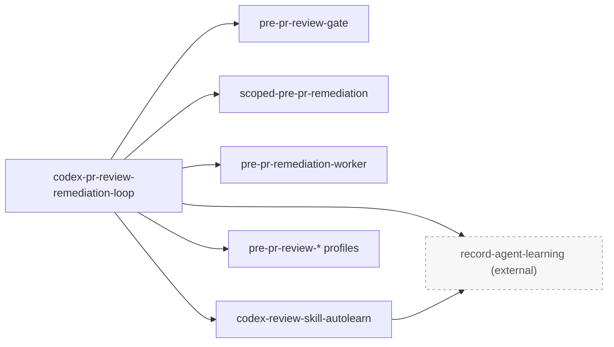
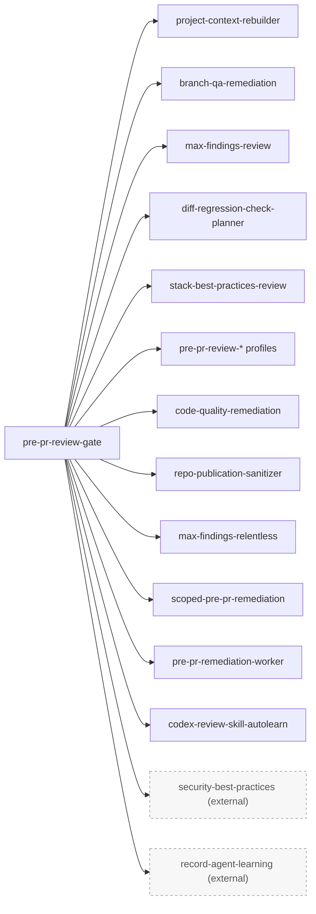
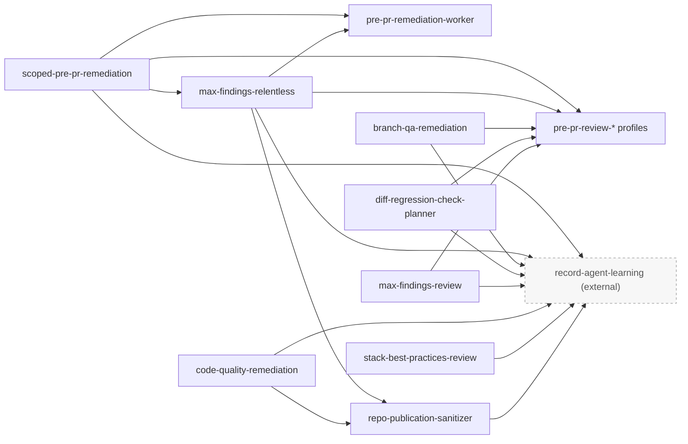
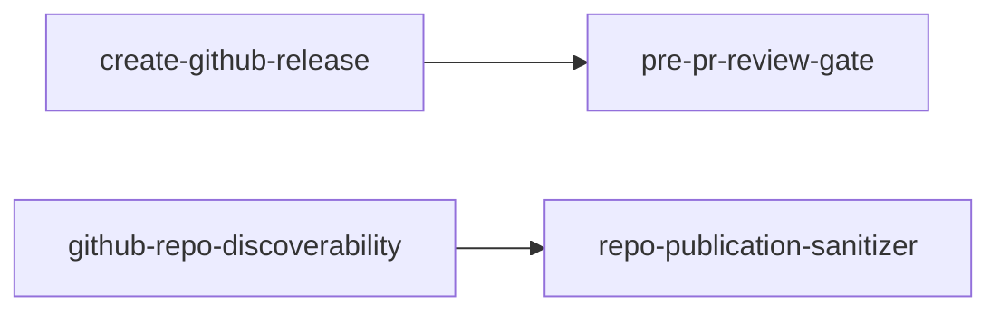

# Personal Agent Skills

Reusable AI-agent skills collected from local workflows and organized for the
`skills` CLI.

## Table of Contents

- [Install](#install)
- [Layout](#layout)
- [Project Files](#project-files)
- [Skills](#skills)
- [Skill Relations](#skill-relations)
- [Maintenance](#maintenance)
- [License](#license)

## Install

Install every skill from this repository:

```bash
npx --yes skills@latest add marcomc/skills --all --full-depth
```

List skills without installing:

```bash
npx --yes skills@latest add marcomc/skills --list --full-depth
```

Install one skill:

```bash
npx --yes skills@latest add marcomc/skills --skill pre-pr-review-gate --full-depth
```

For local validation from this checkout:

```bash
npx --yes skills@latest add . --list --full-depth
```

## Layout

Skills are grouped by category at the repository root as `<category>/<skill>/SKILL.md`.
Use `--full-depth` so the CLI scans every category directory.

## Project Files

| File | Purpose |
| --- | --- |
| [`CHANGELOG.md`](CHANGELOG.md) | Tracks public skill collection changes. |
| [`LICENSE`](LICENSE) | Declares the MIT license for reuse and distribution. |
| [`TODO.md`](TODO.md) | Tracks publication, curation, and maintenance follow-up. |

## Skills

### Codex Workflow

| Skill | Purpose |
| --- | --- |
| [`chatgpt-import`](codex-workflow/chatgpt-import/SKILL.md) | Import ChatGPT desktop conversations into Codex as coding-ready context. |
| [`codex-pr-review-remediation-loop`](codex-workflow/codex-pr-review-remediation-loop/SKILL.md) | Monitor and remediate GitHub PRs under Codex review. |
| [`codex-review-skill-autolearn`](codex-workflow/codex-review-skill-autolearn/SKILL.md) | Distill completed Codex review remediations into reusable skill improvements. |
| [`compact-agents-file`](codex-workflow/compact-agents-file/SKILL.md) | Compact AI-agent instruction files while preserving intent. |
| [`move-codex-chat`](codex-workflow/move-codex-chat/SKILL.md) | Move a Codex chat between local project contexts safely. |
| [`project-context-rebuilder`](codex-workflow/project-context-rebuilder/SKILL.md) | Rebuild project context from repo docs, instructions, specs, and status files. |
| [`sync-codex-skills`](codex-workflow/sync-codex-skills/SKILL.md) | Sync shared `~/.agents/skills` entries into Codex-facing skill mirrors. |
| [`update-agents-workflows`](codex-workflow/update-agents-workflows/SKILL.md) | Update repository agent instructions from observed workflows and commands. |

### Documentation

| Skill | Purpose |
| --- | --- |
| [`doc`](documentation/doc/SKILL.md) | Read, create, edit, and visually validate `.docx` documents. |
| [`document-project-flowcharts`](documentation/document-project-flowcharts/SKILL.md) | Add or refresh Mermaid flowcharts in project documentation. |

### Filesystem Organization

| Skill | Purpose |
| --- | --- |
| [`reorganize-folders`](filesystem-organization/reorganize-folders/SKILL.md) | Analyze and reorganize folders using safe move and rename operations. |

### Frontend UI

| Skill | Purpose |
| --- | --- |
| [`apply-liquid-glass-ui`](frontend-ui/apply-liquid-glass-ui/SKILL.md) | Refactor graphical app UI toward Apple's Liquid Glass design language. |

### Project Scaffolding

| Skill | Purpose |
| --- | --- |
| [`init-python-cli-project`](project-scaffolding/init-python-cli-project/SKILL.md) | Scaffold a local uv-based Python CLI project. |
| [`prepare-ansible-galaxy-role`](project-scaffolding/prepare-ansible-galaxy-role/SKILL.md) | Prepare an Ansible role repository for Galaxy publication. |

### Quality Review

| Skill | Purpose |
| --- | --- |
| [`branch-qa-remediation`](quality-review/branch-qa-remediation/SKILL.md) | Run a PR-style QA review against a base branch. |
| [`code-quality-remediation`](quality-review/code-quality-remediation/SKILL.md) | Review maintainability, duplication, performance, and cleanup opportunities. |
| [`diff-regression-check-planner`](quality-review/diff-regression-check-planner/SKILL.md) | Produce diff-aware regression checks and validation commands. |
| [`max-findings-relentless`](quality-review/max-findings-relentless/SKILL.md) | Repeat review, remediation, and test loops until no findings remain. |
| [`max-findings-review`](quality-review/max-findings-review/SKILL.md) | Maximize real PR or diff findings across any stack. |
| [`native-style-conformance-review`](quality-review/native-style-conformance-review/SKILL.md) | Review whether changes match the surrounding project's native style. |
| [`pre-pr-remediation-worker`](quality-review/pre-pr-remediation-worker/SKILL.md) | Guide edit-capable remediation sub-agents under a coordinator. |
| [`pre-pr-review-agent-workflows`](quality-review/pre-pr-review-agent-workflows/SKILL.md) | Review agent instructions, skills, prompts, and automation guidance. |
| [`pre-pr-review-backend-services`](quality-review/pre-pr-review-backend-services/SKILL.md) | Review backend services, APIs, workers, persistence, and domain logic. |
| [`pre-pr-review-ci-actions`](quality-review/pre-pr-review-ci-actions/SKILL.md) | Review GitHub Actions, CI checks, permissions, caches, and artifacts. |
| [`pre-pr-review-cli-tooling`](quality-review/pre-pr-review-cli-tooling/SKILL.md) | Review CLI, shell, Makefile, installer, and local tooling changes. |
| [`pre-pr-review-config-data-flow`](quality-review/pre-pr-review-config-data-flow/SKILL.md) | Review config, defaults, schemas, generated files, and data contracts. |
| [`pre-pr-review-docs-release`](quality-review/pre-pr-review-docs-release/SKILL.md) | Review docs, changelog, README, release, and PR-readiness text. |
| [`pre-pr-review-frontend`](quality-review/pre-pr-review-frontend/SKILL.md) | Review frontend UI, browser behavior, state, accessibility, and regressions. |
| [`pre-pr-review-gate`](quality-review/pre-pr-review-gate/SKILL.md) | Compose the local pre-PR review stack and report readiness. |
| [`pre-pr-review-infra-runtime`](quality-review/pre-pr-review-infra-runtime/SKILL.md) | Review infrastructure, runtime, deployment, containers, and service lifecycle. |
| [`pre-pr-review-security-boundaries`](quality-review/pre-pr-review-security-boundaries/SKILL.md) | Review auth, secrets, trust boundaries, and privileged side effects. |
| [`pre-pr-review-tests-validation`](quality-review/pre-pr-review-tests-validation/SKILL.md) | Review test coverage, validation strategy, fixtures, and quality gates. |
| [`scoped-pre-pr-remediation`](quality-review/scoped-pre-pr-remediation/SKILL.md) | Review and fix a scoped branch, commit range, diff, or working tree before PR. |
| [`stack-best-practices-review`](quality-review/stack-best-practices-review/SKILL.md) | Review idiomatic stack usage, maintainability, architecture fit, and modernization. |

### Release GitHub

| Skill | Purpose |
| --- | --- |
| [`create-github-release`](release-github/create-github-release/SKILL.md) | Create or update a GitHub release from a local changelog. |
| [`github-repo-discoverability`](release-github/github-repo-discoverability/SKILL.md) | Improve repository metadata, topics, labels, README, and discoverability. |
| [`pr-description-markdown`](release-github/pr-description-markdown/SKILL.md) | Generate a Markdown PR description from git diff and log. |
| [`repo-publication-sanitizer`](release-github/repo-publication-sanitizer/SKILL.md) | Sanitize a repository before public release or PR publication. |

### Spec Workflow

| Skill | Purpose |
| --- | --- |
| [`generate-speckit-constitution-prompts`](spec-workflow/generate-speckit-constitution-prompts/SKILL.md) | Generate prompt blocks for `/speckit.constitution`. |
| [`generate-speckit-specify-prompts`](spec-workflow/generate-speckit-specify-prompts/SKILL.md) | Generate prompt blocks for `/speckit.specify`. |
| [`speckit-kanban-sync`](spec-workflow/speckit-kanban-sync/SKILL.md) | Sync generated Speckit tasks into `TODO.kanban`. |

### Task Management

| Skill | Purpose |
| --- | --- |
| [`add-todo`](task-management/add-todo/SKILL.md) | Capture user ideas into the active project TODO artifact. |

### Tooling MCP

| Skill | Purpose |
| --- | --- |
| [`mcpone-install-mcp-server`](tooling-mcp/mcpone-install-mcp-server/SKILL.md) | Install or update an MCP server in McpOne and enable it in Codex Cluster A. |

## Skill Relations

Only skills with a detected `$skill-name` reference are shown. External nodes are
referenced by included skills but are intentionally not bundled in this repo.

### PR Review Coordination

This flow shows the top-level PR review loop and the skills it dispatches.



### Pre-PR Gate Composition

This flow shows the review, cleanup, remediation, and learning skills composed
by `pre-pr-review-gate`.



### Remediation and Learning Paths

This flow shows the skills that feed review profiles, sanitization, and reusable
agent-learning capture.



### Release and Publication Entrypoints

This flow shows the release-oriented skills that hand off into the review and
sanitization stack.



## Maintenance

Refresh from the installed local source only after rechecking provenance:

```bash
npx --yes skills@latest add . --list --full-depth
find . -name '*.md' -print0 | xargs -0 markdownlint --config /Users/mmassari/.markdownlint.json
find . -name '*.sh' -print0 | xargs -0 shellcheck --enable=all
```

## License

This repository is released under the [MIT License](LICENSE).
