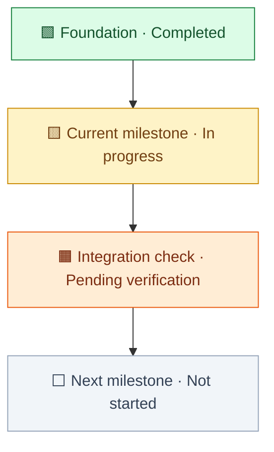

# Visual design

## Reading and interaction

Design for a reader who can become overwhelmed by technical prose or competing
controls. Use a mature, restrained visual style: familiar line icons, consistent
spacing, a clear hierarchy and a small number of status accents. The goal is
lower reading and memory demand, not a claim of clinical validation for ADHD.

- Show the compact vertical status flow immediately for progress updates. Use
  the interactive hybrid for useful drill-down or an explicit request.
- Keep a consistent order across runs: desired result, necessary work and
  blockers, already available work, proposed deferrals, evidence/coverage.
- Give each activity one short outcome label. Add type cues only when useful.
  Keep development, execution and chat runtime distinct; show concise rows only
  where a single status label could mislead.
- For interactive output, use a native disclosure or a labeled “Details” button
  on the activity itself. Avoid a separate picker and status-edit controls.
  Opening details is inspection; state comes from collected evidence.
- Put the exact next step and why it matters in details, with source references
  further disclosed. Keep important user decisions visible in the overview.
- Use at most two parallel branches when readable. Reflow vertically on narrow
  screens without reducing text size; split large projects by workstream.
- Use whitespace and grouping instead of decorative illustrations, gradients,
  flashing indicators or looping motion. Keep the map stable while inspected;
  display a new dated snapshot rather than silently moving nodes during reading.

## Default progress flow

Use this stable palette for ordinary status nodes. Pair every color with a
localized word and square symbol; color alone never communicates state.

| State | Accent / symbol | Meaning |
| --- | --- | --- |
| Completed | Green / 🟩 | The stated acceptance scope is complete with relevant evidence. |
| Active | Yellow / 🟨 | Implementation or review is in progress; name which. |
| Planned | Neutral gray / ⬜ | Not started, including authorized work waiting on dependencies. |
| Check pending | Orange / 🟧 | Integration, validation or a technical condition still needs checking. |
| Blocked | Red / 🟥 | A confirmed obstacle prevents progress; name owner and clearing condition. |
| Unknown | Neutral gray / ❔ | Evidence is unavailable or conflicting; do not guess readiness. |

Merged code, a closed chat turn or an authorization is not sufficient to color
a whole capability green. A real blocker is not the same as ordinary future work
or a scheduled test. Separate real human decisions from technical waits. Preserve
execution labels such as Auto approved, In progress or In review when they matter.

The example below is fictional presentation data. Replace its labels and edges
with the actual scope; do not copy its sequence as an inferred dependency chain.

State whether arrows represent dependencies or a broad rollout sequence. Do not
create artificial blocking steps, completion percentages or universal linear
ordering. Add a red node only for an evidenced blocker. When no significant
blocker is known, say so with the observation scope rather than inventing one.
For HTML rendering use the theme-aware color contract in `visualize`; the fixed
Mermaid palette above is for static diagrams.

## Icons and states

Use one consistent icon family. Match the work's actual type rather than adding
media imagery to unrelated projects. Familiar examples:

| Work type | Example line icon | Meaning |
| --- | --- | --- |
| Audio | Microphone or waveform | Audio generation, recording or processing. |
| Video | Clapperboard or film | Video generation, editing or delivery. |
| Images | Image | Images or visual assets. |
| Text/document | File text | Written content, specification or document. |
| Data | Database | Data import, storage or analysis. |
| Infrastructure | Server or cloud | Runtime, service or deployment work. |
| Application logic | Code | Software implementation. |
| Validation | Clipboard check | Testing or acceptance work. |
| User decision | User round | A decision or action actually needed from the user. |
| Milestone | Flag or target | A checkable useful result. |
| Unclear type | Circle help | Unknown work type; keep its plain-language label. |

Type icons and work states are different dimensions: an audio icon never means
“running.” Pair a state accent with a localized word such as Done, In progress,
Waiting, Needs your decision, Blocked or Uncertain. Keep colors and meanings
consistent across the report and later refreshes. Include the compact status
legend in progress flows; other views need a legend only when labels do not
explain their encoding directly.

Use a neutral development symbol distinct from the execution cue:

| Development token | Example symbol | Visible meaning |
| --- | --- | --- |
| `planned` | Clipboard list | Planned; not built. |
| `building` | Hammer | Implementation or integration is being completed. |
| `partial` | Blocks | Some concrete parts exist; the whole capability is partial. |
| `implemented` | Code | Specified functionality exists; remaining integration or tests stay explicit. |
| `verified` | Badge check | Specified scope has acceptance evidence. |
| `unknown` | Circle help | Readiness has not been established. |
| `not_applicable` | No development row | A decision or outcome, rather than a capability to build. |

Execution can use an hourglass for waiting, a timer for running, a stop symbol
for blocked and a check for completed. Pair each with its localized dimension
label and status text; neither its color nor its icon replaces the words.
For a partial capability, say partial in the visible development label and name
the available part, for example “Partial · technical checker present”.

For inline HTML, use the host-provided icon library when available; the bundled
template uses Lucide placeholders. Keep meaningful type and state words visible
if icons fail. For Mermaid or exported images, use available labeled symbols
and shapes rather than depending on a missing font or icon package.

## Template adaptation

`assets/hybrid-brief.html` is an inline fragment with an English fictional model.
Replace its `brief` object as a whole for the selected project. Set `example`
false only after replacing all fictional nodes, source details and labels.

- Localize every visible and accessible model string, including control labels,
  runtime descriptions, status names, detail headings and coverage.
- Keep model keys, IDs and `kind`/`state` tokens stable; they are implementation
  identifiers and are not displayed. Preserve exact source titles in values.
- Each capability supplies `developmentState`, `developmentText`, `built` and
  `buildRemaining`, with evidence for those claims. `state`/`stateLabel` describe
  execution independently. Missing readiness renders unknown, including when
  execution says waiting. Localize the development/execution labels and detail
  headings; optional per-node dimension labels can suit non-software work.
- `rows` controls primary workstream arrangement; each row has one or two IDs.
  `edges` contains evidenced prerequisite-to-dependent relationships only.
- Keep template edges forward in reading order. For a dependency cycle or dense
  cross-links, show an explicitly labeled unresolved group in the overview and
  a separate branch map; preserve the actual relationships in its detail.
- Put already available or proposed later items in `support` groups; use
  additional groups or branch maps to account for every workstream.
- Use native disclosures for details. Keep all interactions local and read-only;
  no API request, chat message or status mutation belongs in the fragment.
- Treat source text as data. Use DOM text APIs, safe source links and a JSON
  serializer that escapes `<` when embedding data into an inline script.

Before presenting a generated brief, verify the primary detail interaction,
all references, icons or text fallbacks, and readability at normal and narrow
widths. Check light/dark contrast, keyboard disclosure controls, text enlargement
and reduced-motion behavior. Treat evidence coverage and accessibility checks
as separate results; an attractive view does not validate the underlying plan.

## Research basis

These are original implementation choices informed by primary sources, not
copied source material or a requirement to reread external guidance every run.

- [W3C: helpful icons](https://www.w3.org/WAI/WCAG2/supplemental/patterns/o1p07-icons-used/) supports familiar, consistently meaningful symbols beside the related text and warns against icon clutter.
- [W3C: clear structure](https://www.w3.org/WAI/WCAG2/supplemental/patterns/o2p03-page-structure/) supports distinguishable regions, grouping and a familiar information hierarchy for readers overwhelmed by dense content.
- [W3C: clear controls](https://www.w3.org/WAI/WCAG2/supplemental/patterns/o1p05-clear-controls/) supports recognizable controls whose operation is apparent.
- [W3C: use of color](https://www.w3.org/WAI/WCAG22/Understanding/use-of-color) supports a text or shape cue in addition to status color.
- [Impact Mapping](https://www.impactmapping.org/drawing.html) supports linking deliverables to desired results; [Kanban University](https://kanban.university/kanban-guide/) supports making work and impediments visible.
