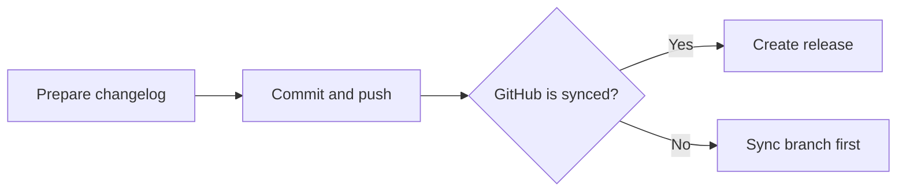

<!-- MARCOMC-SKILL: owner="MarcoMC <marco@marcomc.com>"; repository="marcomc/skills"; provenance="original" -->

# Document Project Flowcharts

Add source-backed Mermaid flowcharts to project documentation so procedures are
easier to understand and stay close to the files that define them.

## Core Rule

Document the real workflow from the repository, not an invented ideal flow.
Search configuration, scripts, workflows, and docs first; then update the
Markdown surface that readers actually use.

## Discovery

1. Start at the repository root with `git rev-parse --show-toplevel`.
2. Read project instructions such as `AGENTS.md`, `CLAUDE.md`,
   `.github/copilot-instructions.md`, and README contribution notes.
3. Search beyond the root for workflow sources:
   - `README*`, `docs/**/*.md`, `runbooks/**/*.md`, `CHANGELOG.md`
   - `.github/workflows/*`, `Makefile`, `Taskfile*`, `justfile`
   - `Dockerfile*`, `docker-compose*.yml`, `compose*.yml`
   - `pyproject.toml`, `package.json`, `workspace.yml`, `mkdocs.yml`
   - `ansible/`, `playbooks/`, `terraform/`, `helm/`, `charts/`, `scripts/`
4. Treat config files as evidence. Put Mermaid blocks in Markdown docs unless
   the config format and project convention explicitly support rendered Mermaid.
5. If a procedure is defined in config but has no docs, add or update the
   nearest appropriate Markdown guide instead of hiding diagrams in config
   comments.

## Diagram Placement

- Prefer the document that already explains the workflow.
- Keep the diagram near the procedure it clarifies, not in a detached gallery.
- Add one sentence before each diagram stating its scope.
- Do not duplicate the same diagram in multiple docs; link to the canonical doc.
- If editing a README materially, refresh its table of contents when the repo
  rules require it.

## Mermaid Defaults

Use fenced Mermaid blocks in Markdown:

Default to `flowchart LR` for operator procedures because it reads like a
left-to-right checklist. Use short, single-line labels and quote labels that
contain punctuation, symbols, or spaces.

## Layout Decisions

- Use `flowchart LR` for linear operator flows, release procedures, CI paths,
  setup sequences, and happy-path process explanations.
- Use `flowchart TB` when the process has many cross-links, stacked
  dependencies, retry loops, or vertical fan-out that would make `LR` cross
  lines heavily.
- Split a long horizontal flow into separate Mermaid blocks when it exceeds
  roughly 8 to 10 nodes, has more than two major phases, or needs horizontal
  scrolling to read.
- Split at logical boundaries: trigger, preparation, validation, deployment,
  rollback, cleanup, or handoff.
- Prefer two named parts over one unreadable diagram. End part one with an
  explicit handoff node and start part two with the same handoff context.
- Use `subgraph` only when grouping adds meaning, such as actor ownership,
  environment, or phase boundaries. Avoid decorative subgraphs.

## Readability Rules

- Keep node text action-oriented and concise.
- Use decision diamonds only for real branches and label outgoing edges.
- Avoid crossing arrows; split or rotate the diagram instead.
- Keep the main path visually dominant. Move rare error handling to a second
  diagram or a short table when it would obscure the main flow.
- Use stable node IDs such as `validate`, `deploy`, or `rollback`; keep human
  text in quoted labels.
- Avoid heavy styling unless the repo already has a diagram style convention.
- Add `accTitle` and `accDescr` for diagrams that explain important workflows.
- Avoid lowercase `end` as node text and avoid edge syntax that accidentally
  starts with `o` or `x`; these are Mermaid flowchart parser gotchas.

## Preview Troubleshooting

- If a Mermaid block renders as blank space but the diagram is syntactically
  valid, suspect an overly wide SVG canvas (very long `LR` flows, long labels,
  or many nodes in one row) before assuming a syntax error.
- Split the diagram into smaller blocks by phase, keep labels short, and prefer
  `flowchart TB` when the graph is naturally tall.
- Render the Mermaid block locally (for example with Mermaid CLI) and inspect
  the resulting SVG `viewBox`, width, and max-dimensions to confirm whether the
  output is simply too wide for the preview surface.
- If the editor has both a built-in Mermaid renderer and an extension-based
  renderer enabled, temporarily disable the extension renderer to rule out
  renderer conflicts.

## Update Workflow

1. Build a source map: which config/script/doc proves each procedure step.
2. Choose the target docs and list why each diagram belongs there.
3. Draft the diagram before editing files; remove steps that cannot be traced to
   repo evidence.
4. Insert or refresh Mermaid blocks and surrounding prose.
5. Validate Markdown with the repo-required markdownlint command.
6. If available, run the repo's docs build, Mermaid renderer, or link checker.
7. Re-read the rendered-source Mermaid for syntax risks: unquoted labels,
   unlabeled decisions, crossings, duplicate node IDs, and excessive width.

## Reference Basis

- Mermaid flowchart syntax: <https://mermaid.js.org/syntax/flowchart.html>
- Mermaid accessibility: <https://mermaid.js.org/config/accessibility.html>
- Mermaid syntax and layout options:
  <https://mermaid.js.org/intro/syntax-reference>
- Process-flow documentation practice: <https://asq.org/quality-resources/flowchart>
